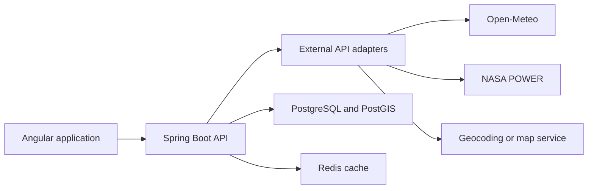

# ShambaNexa

Multi-farm management for cattle, goats, sheep, poultry, pigs, and fish. The Angular app reads dashboard figures from the Spring Boot API, and PostgreSQL is the system of record.

Brand colors: green `#2E7D32`, gold `#C19A3A`, cream `#FFFBF0`, sidebar `#1A2E1A`.

## Run locally

Java 17, Node.js, and PostgreSQL 16 or 17. The API defaults to `localhost:5432`, database `shambanexa_db`, user `postgres`, password `password`. Override with `DB_URL`, `DB_USER`, and `DB_PASSWORD`.

`docker compose up -d` starts PostgreSQL 16 as database `shambanexa`, user `shambanexa`, password `shambanexa`. Use that database with:

```bash
cd backend && DB_URL=jdbc:postgresql://localhost:5432/shambanexa DB_USER=shambanexa DB_PASSWORD=shambanexa mvn spring-boot:run
```

Otherwise start the API with its defaults:

```bash
cd backend && mvn spring-boot:run
cd frontend && npm install && npm start
```

The API listens on port 8081 so it does not collide with another local Spring app on 8080. The Angular dev server proxies `/api` to that port.

Open http://localhost:4200.

| Account | Password | Role | Scope |
| --- | --- | --- | --- |
| admin@shambanexa.com | Admin@123 | Super Admin | All farms, including Users & Roles |
| manager@shambanexa.com | Manager@123 | Farm Manager | Northern Farm. Updates livestock, stock, staff, and farm records |
| adviser@shambanexa.com | Adviser@123 | Farm Adviser | Central Farm. Publishes advice. Does not change operational records |

Flyway applies schema migrations, then the demo portfolio in `backend/src/main/resources/db/demo`. Start with `--spring.profiles.active=prod` to run migrations only.

API docs: http://localhost:8081/swagger-ui.html

## Roles

A person holds one role. Assigning another role replaces it.

- **Super Admin** manages users and can grant Own Farm Only, Selected Farms, or All Farms. The last admin cannot be demoted.
- **Farm Manager** updates livestock, stock, staff, and farm records inside the assigned scope. A manager with All Farms can read every farm and still cannot open Users & Roles.
- **Farm Adviser** posts advice and medication notes that every signed-in user can read, and keeps a public listing. Farm data stays inside the assigned scope. The adviser does not change livestock, stock, or staff records.
- **Auditor** can read the assigned farms and cannot write operational records.

Registration joins the existing workspace as a Farm Manager on Own Farm Only, after the farm location and boundary are drawn.

## What this release covers

- Sign-in, registration, and farm-scoped access enforced in the API and the app
- Farms, facilities, species, tagged animals, herd batches, and a Tanzania map of farm locations
- Disease, sick, death, and cure reports, with open health alerts drawn on the map
- Append-only movement ledger with idempotent registration and transfer
- Dashboard counts, milk, revenue, alerts, and an activity feed computed from stored rows
- Production, fish-cycle estimates, inventory adjustments, staff, and tasks
- Expert advice visible across the workspace, with optional medication name and note
- Farm Adviser directory: map pin, talent search, availability, load from open alerts and tasks, ratings, and recommendations
- Separate Farm Manager operations screens and Farm Adviser overview
- CSV export of the same figures the dashboard shows

Animal-level treatment withdrawal dates are now visible as advisory records; automatic sale restrictions and guaranteed clearance remain out of scope. Full finance journals and offline sync also remain out of scope. NASA POWER is called for the historical climate card on a farm. Open-Meteo is called for the 7-day forecast on a farm. The other services in this list are not called yet. Farm coordinates and boundaries stay in PostgreSQL, and the map is drawn in the app. Jurisdictional compliance is not claimed.

## Livestock lifecycle records (November 2026)

Animal profiles now include **Weight history**, **Breeding**, and **Treatments** tabs alongside the existing Overview and Health tabs. Open Livestock, choose a tagged animal, and select a tab. Forms and histories use the API and PostgreSQL rather than mock data.

- **Weight history:** append a measurement with date, positive weight in kilograms (up to 99,999.999 kg) and optional notes. Earlier measurements remain available.
- **Breeding:** append an event of type `MATING`, `INSEMINATION`, `PREGNANCY_CHECK`, `PREGNANCY_CONFIRMED`, `BIRTH`, `LOSS`, or `WEANING`, with an event date, optional expected birth date and notes. The backend also accepts a same-species `partnerAnimalId` and `offspringCount`, but the current profile form does not expose these fields. Parent–offspring genealogy is **not** complete.
- **Treatment traceability:** view animal-specific treatments and associated dose withdrawal dates where available, plus an advisory active-withdrawal indicator based on recorded dose and vaccination dates. Missing data **must not** be treated as proof that an animal or its products are cleared for sale. No automatic sales block has been implemented.

### Animal lifecycle API

All paths are under `/api/v1/animals/{animalId}`. Authentication, tenant/farm scope and animal write authority apply. Dates use ISO `YYYY-MM-DD`.

| Method | Path | Purpose |
| --- | --- | --- |
| GET | `/weights` | List the latest 500 dated measurements, newest first |
| POST | `/weights` | Append a weight measurement |
| GET | `/breeding` | List the latest 500 breeding events |
| POST | `/breeding` | Append a breeding event |
| GET | `/treatment-history` | List treatments joined to dose records (up to 500 rows) |
| GET | `/withdrawal-status` | Return recorded active withdrawal periods and an `asOf` date |

Example request bodies:

```json
{"weightKg": 320.5, "measuredOn": "2026-11-08", "notes": "Morning measurement"}
```

```json
{"eventType": "PREGNANCY_CONFIRMED", "eventOn": "2026-11-08", "expectedBirthOn": "2027-06-15", "notes": "Vet confirmed"}
```

The example values above illustrate request formats; they are **not** real farm records. The implementation uses append-only `animal_weights` and `animal_breeding_events` tables added by `backend/src/main/resources/db/migration/V118__animal_lifecycle.sql`, with `tenant_id`, `animal_id`, `recorded_by`, and creation timestamps. New writes are also sent to the audit trail.

**Important limitations:** The API returns database-style snake_case keys for history reads; the create responses use camelCase. The treatment endpoint is a read-only history view, not a medicine-administration form. The withdrawal indicator is based on recorded issued doses/vaccinations and end dates; it is not a veterinary certification or a compliance guarantee.

### Build and verification

The GitHub Actions workflow at `.github/workflows/build-and-test.yml` runs the Angular production build and Maven unit tests on pushes to the feature branch and on pull requests. Workflow run [42475763972](https://github.com/codenfig/shambanexa/actions/runs/42475763972), for commit `11acd11f886f542981c11f437e771d18160deea3`, completed **successfully**. This confirms compilation and existing tests, **not** that the Flyway migration has been exercised against PostgreSQL or that the complete lifecycle workflows have passed end-to-end testing. Component stylesheet budgets were increased to accommodate the current UI; remaining CSS size warnings should be reviewed.

### Remaining release tasks

1. Run Flyway against a disposable PostgreSQL database and verify constraints and references.
2. Add integration tests for tenant/farm authorization, input validation, record ordering and withdrawal queries.
3. Enforce treatment withdrawal rules in livestock/product sales, including missing-data handling and authorized overrides.
4. Complete breeding partner/offspring linking, genealogy and due-date reminders.
5. Add growth charts, meaningful weight-change summaries and clinical traceability exports.
6. Review dependency audit findings, accessibility, mobile behavior and production backup/restore procedures.

See [competitive gap audit](docs/competitive-gap-audit-2026-11.md) for the wider roadmap.

## External services

Angular does not call outside services. The Spring Boot API owns every outbound request.

The first combination is Open-Meteo, OpenStreetMap with MapLibre, and NASA POWER. Add FAOSTAT and GBIF only for reports and reference data, not for daily farm transactions. Defer SoilGrids.

| Priority | Service | ShambaNexa use | Recommendation |
| --- | --- | --- | --- |
| 1 | Open-Meteo | Forecasts, rain, temperature, wind, humidity, and soil-moisture estimates | Weather for the first adapter |
| 2 | OpenStreetMap | Farm maps, locations, and boundary drawing | Open mapping data |
| 3 | NASA POWER | Historical rainfall, temperature, solar radiation, and climate analysis | Long-term farm planning |
| 4 | FAOSTAT | National agricultural production and livestock statistics | Reports and comparisons only |
| 5 | GBIF | Species-name validation and biodiversity reference data | Optional reference |
| 6 | SoilGrids | Regional soil-property layers | Defer, or use WCS with care |



The API should hide credentials, cache weather by farm coordinates for 30–60 minutes, and cache geocoding results where the provider allows it. Use timeouts, retries, and a circuit breaker, and keep the app working when a provider is down. Store the source, retrieval time, and required attribution. Refresh on a schedule instead of calling out on every dashboard load. Keep provider values apart from figures a farmer or a sensor recorded.

### Open-Meteo

Use Open-Meteo for current farm weather, a 7-to-16-day forecast, rainfall probability, temperature, humidity, wind, soil temperature, modelled soil moisture, historical weather, and alerts raised by ShambaNexa rules. Label the result as advisory information, not a guaranteed reading at the farm.

The non-commercial API needs no key and allows up to 10,000 calls a day. The data is CC BY 4.0, so the screen must attribute Open-Meteo. A commercial deployment needs their commercial plan or a self-hosted copy.

```text
GET https://api.open-meteo.com/v1/forecast
  ?latitude=-6.7924
  &longitude=39.2083
  &current=temperature_2m,relative_humidity_2m,precipitation,wind_speed_10m
  &daily=weather_code,temperature_2m_max,temperature_2m_min,precipitation_sum
  &timezone=Africa/Dar_es_Salaam
```

The farm page shows this 7-day forecast for the farm's coordinates, with open disease reports, sick-animal reports, and health cases stored for farms the user can see in that region. The forecast does not name a new disease or choose a medicine.

### OpenStreetMap and MapLibre

Use OpenStreetMap for the geography, MapLibre GL JS or Leaflet in Angular, PostGIS for boundaries, and GeoJSON between Angular and Spring Boot. The map should place the farm, draw and edit the boundary, estimate area, and show animals, facilities, alerts, and adviser assignments.

Do not depend on the public OpenStreetMap tile servers in production. They have no service guarantee and do not allow bulk tile downloads. Show `© OpenStreetMap contributors` and link to the OpenStreetMap licence.

The public Nominatim geocoder allows at most one request per second, does not allow client-side autocomplete, and is a poor fit for bulk lookup. Use it only for development or a low-volume manual search, through the API, with caching. For production, self-host Nominatim and tiles, use a hosted map provider, or serve a Tanzania OpenStreetMap extract from ShambaNexa infrastructure.

### NASA POWER

Use NASA POWER for historical rainfall, temperature trends, solar radiation, drought indicators, seasonal planning, and comparing farm performance with climate. It offers hourly, daily, monthly, and climatology data as JSON or CSV. Open-Meteo stays the operational forecast. NASA POWER stays the historical record.

The farm climate card requests rainfall, temperature, humidity, dew point, wet-bulb temperature, wind, sunlight, plant light, soil wetness, and land evaporation. It compares rainfall, water loss, and root-zone wetness with the POWER climatology for the same dates. Dry days, the longest dry spell, hot days, cold nights, livestock heat-stress days, and growing degree days are counted from those daily values. Active fires, GPM rain, and MODIS pasture greenness need a NASA account and are not called.

```text
GET https://power.larc.nasa.gov/api/temporal/daily/point
  ?parameters=PRECTOTCORR,T2M_MAX,T2M_MIN,RH2M,T2MDEW,T2MWET,WS2M,ALLSKY_SFC_SW_DWN,ALLSKY_SFC_PAR_TOT,GWETTOP,GWETROOT,EVLAND
  &community=AG
  &longitude=39.2083
  &latitude=-6.7924
  &start=20260101
  &end=20261024
  &format=JSON
```

### FAOSTAT, GBIF, and SoilGrids

FAOSTAT is for Tanzania livestock statistics, production trends, commodity comparisons, national reporting, and benchmarking the portfolio. It is not a source for a farm inventory, a local price, or a live transaction. Those stay in PostgreSQL.

GBIF can check scientific names, classifications, synonyms, and biodiversity records. It is optional. ShambaNexa already keeps master data for cattle, goats, sheep, poultry, pigs, and fish.

SoilGrids models soil properties at about 250-metre resolution. Its REST API is paused and is not a dependency. If a regional hint is needed later, use WCS, WMS, or WebDAV, say that the layer is regional, and let the farmer enter a laboratory soil test.

### Order of work

1. OpenStreetMap and MapLibre for the farm map.
2. PostgreSQL with PostGIS for boundaries.
3. Open-Meteo for operational weather.
4. NASA POWER for historical climate.
5. Internal master data for livestock, diseases, and medicines.
6. FAOSTAT and GBIF only in later report and reference modules.

Do not call a public AI or veterinary API to prescribe medication. A medication name and note come from an authorized Farm Adviser, or from approved master data.
